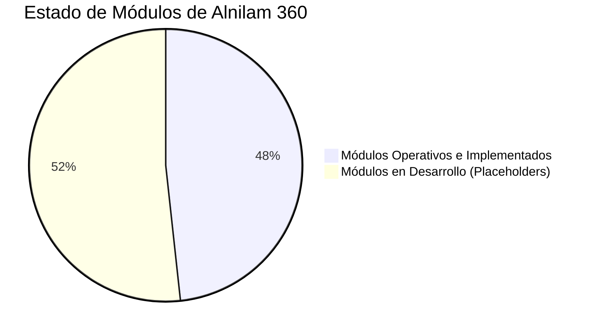

# ALNILAM 360 · DOCUMENTACIÓN FUNCIONAL Y ESTADO DEL MENÚ LATERAL

> **Versión del Sistema:** Alnilam 360 v2.0  
> **Arquitectura:** Angular 20 · Ionic Framework 8 · Tailwind CSS · PrimeNG 19 · Supabase (PostgreSQL + RLS + Storage)  
> **Metodología Base:** Ciclo PHVA (Planear, Hacer, Verificar, Actuar) · Decreto 1072 de 2015 · Resolución 0312 de 2019

---

## 1. Visión General de la Plataforma

**Alnilam 360** es una solución web empresarial integral para la administración, control y auditoría del Sistema de Gestión de Seguridad y Salud en el Trabajo (**SG-SST**).

### Pilares Arquitectónicos
1. **Multi-Tenancy Dinámico:** Gobernanza aislada por empresa mediante `empresa_id` con políticas de seguridad a nivel de base de datos (**Row Level Security - RLS**).
2. **Ciclo PHVA Estandarizado:** Organización de menús y flujos conforme a las 4 fases del ciclo de mejora continua.
3. **Reactividad Moderna con Signals:** Gestión de estado reactivo sincrónico/asincrónico sin sobrecarga de suscripciones manuales.
4. **Diseño de Interfaz SaaS Ejecutiva:** Paleta dark/light adaptable, microanimaciones, visualizaciones de datos y componentes PrimeNG para alto rendimiento tabular.

---

## 2. Inventario de Opciones del Menú Lateral

A continuación se detalla el estado actual de cada opción del menú lateral de navegación:

| Sección / Grupo | Opción del Menú | Ruta Angular | Estado | Tipo de Implementación |
| :--- | :--- | :--- | :---: | :--- |
| **INICIO** | **Inicio (Dashboard)** | `/dashboard` | OPERATIVO | Vista con KPIs globales, avance SG-SST y actividad reciente. |
| **PLANEAR (P)** | **Política, Objetivos y Metas** | `/documentos/controlados/politicas` | EN DESARROLLO | Vista estándar de placeholder (`DocumentosModule`). |
| **PLANEAR (P)** | **Evaluación Inicial** | `/gestion-sst/evaluaciones` | OPERATIVO | Evaluación Res. 0312/2019 (7, 21 o 60 estándares calculados). |
| **PLANEAR (P)** | **Plan Anual de Trabajo** | `/gestion-sst/planes/plan-trabajo` | OPERATIVO | Cronograma anual, responsables, modal de actividades y avance. |
| **PLANEAR (P)** | **Matriz Legal** | `/documentos/catalogos/matriz-requisitos` | EN DESARROLLO | Vista estándar de placeholder (`DocumentosModule`). |
| **PLANEAR (P)** | **Recursos y Responsables** | `/personal/roles` | EN DESARROLLO | Vista estándar de placeholder (`PersonalModule`). |
| **HACER (H)** | **Gestión de Peligros y Riesgos** | `/gestion-sst/matriz-iperc` | OPERATIVO | Matriz IPERC (GTC 45), evaluación, medidas y exportación Excel. |
| **HACER (H)** | **Gestión de la Salud** | `/formatos/seguimiento-examenes` | EN DESARROLLO | Vista estándar de placeholder (`FormatosModule`). |
| **HACER (H)** | **Capacitación y Competencias** | `/gestion-sst/planes/capacitaciones` | EN DESARROLLO | Vista estándar de placeholder (`PlanesModule`). |
| **HACER (H)** | **Contratistas y Proveedores** | `/personal/asignaciones` | EN DESARROLLO | Vista estándar de placeholder (`PersonalModule`). |
| **HACER (H)** | **Comunicación y Participación** | `/gestion-sst/planes/estilos-vida` | EN DESARROLLO | Vista estándar de placeholder (`PlanesModule`). |
| **VERIFICAR (V)** | **0. Matriz de Indicadores** | `/indicadores/matriz-indicadores` | OPERATIVO | Matriz consolidada normativa con catálogo, cascada y control duplicados. |
| **VERIFICAR (V)** | **1. Accidentalidad (AT)** | `/indicadores/accidentalidad` | OPERATIVO | Dashboard AT, Pirámide de Bird, Heatmap corporal, Matriz de Casos y wizard. |
| **VERIFICAR (V)** | **2. Enfermedad Laboral (EL)** | `/indicadores/enfermedad-laboral` | OPERATIVO | Casos EL, Prevalencia, Incidencia, CIE-10, PCL y exportación. |
| **VERIFICAR (V)** | **3. Ausentismo Laboral** | `/indicadores/ausentismo` | OPERATIVO | Incapacidades AT/EL/EG, cálculo de costos ARL/EPS/empresa e indicadores. |
| **VERIFICAR (V)** | **4. Estructura, Proceso y Resultado** | `/indicadores/sg-sst` | OPERATIVO | 24 indicadores Decreto 1072/2015, evaluación periódica y gráficos. |
| **VERIFICAR (V)** | **Auditorías e Inspecciones** | `/auditorias/programacion` | EN DESARROLLO | Vista estándar de placeholder (`AuditoriasModule`). |
| **VERIFICAR (V)** | **Investigación de AT/EL** | `/investigacion-atel` | EN DESARROLLO | Vista independiente de placeholder (`IncidentesModule`). |
| **VERIFICAR (V)** | **Cumplimiento Legal** | `/documentos/catalogos/matriz-requisitos` | EN DESARROLLO | Vista estándar de placeholder (`DocumentosModule`). |
| **VERIFICAR (V)** | **Revisión por la Alta Dirección** | `/gestion-sst/plan-mejora` | OPERATIVO | Dashboard de planes de mejora derivados de la evaluación y dirección. |
| **ACTUAR (A)** | **Acciones Correctivas** | `/acciones-correctivas` | EN DESARROLLO | Vista independiente de placeholder (`FormatosModule`). |
| **ACTUAR (A)** | **Acciones Preventivas** | `/gestion-sst/incidentes/actos-condiciones` | EN DESARROLLO | Vista estándar de placeholder (`IncidentesModule`). |
| **ACTUAR (A)** | **Mejora Continua** | `/gestion-sst/plan-mejora` | OPERATIVO | Matriz y seguimiento de acciones preventivas, correctivas y de mejora. |
| **UTILIDADES** | **Documentos** | `/documentos/controlados/politicas` | EN DESARROLLO | Vista estándar de placeholder (`DocumentosModule`). |
| **UTILIDADES** | **Reportes** | `/reportes/indicadores` | EN DESARROLLO | Vista estándar de placeholder (`ReportesModule`). |
| **CONFIGURACIÓN**| **Empresas** | `/configuracion/empresas` | OPERATIVO | Administración de empresas, sedes, logo y datos tributarios. |
| **CONFIGURACIÓN**| **Roles** | `/configuracion/roles` | OPERATIVO | Gestión de roles y permisos granulares por módulo. |
| **CONFIGURACIÓN**| **Usuarios** | `/configuracion/usuarios` | OPERATIVO | Creación y administración de usuarios y vinculación multi-empresa. |
| **CONFIGURACIÓN**| **Trabajadores** | `/configuracion/trabajadores` | OPERATIVO | Maestro de trabajadores con paginación y modal de Cargue Masivo Excel. |
| **UTILIDADES** | **Ayuda y Soporte** | — | EN DESARROLLO | Botón utilitario sin funcionalidad backend asignada. |

---

## 3. Detalle de Módulos Operativos y Funcionalidades Implementadas

### 3.1. Módulo 0: Matriz de Indicadores Consolidada
* **Ubicación:** `/indicadores/matriz-indicadores`
* **Persistencia:** Tabla `public.matriz_indicadores_registros` en Supabase.
* **Funcionalidades:**
  * **Catálogo Oficial:** Incorpora los 9 indicadores estándar de la normatividad colombiana (Severidad AT, Frecuencia AT, Mortalidad AT, Prevalencia EL, Incidencia EL, Ausentismo por Incapacidades, Indicadores de Estructura, Proceso y Resultado).
  * **Cascada Reactiva con Angular Signals:** Al seleccionar el campo *Tipo*, se recalculan al instante los indicadores normativos habilitados para ese grupo, autocompletando fórmulas, metas sugeridas y periodicidad.
  * **Regla de Unicidad Estricta:** Validación dual (frontend y base de datos mediante índice único `idx_matriz_ind_reg_unique_empresa_periodo_nombre`) que impide registrar dos indicadores con el mismo nombre en la misma empresa y periodo.
  * **Cálculo Automático de Cumplimiento:** `Resultado >= Meta ? 'CUMPLE' : 'NO CUMPLE'`.
  * **Tabla SaaS Ejecutiva:** Exclusión de la fórmula en la vista pública (conservada en la ficha técnica del modal), monogramas de avatar para responsables, micro barras de desempeño relativo, cálculo de variaciones (+/- Delta %) y píldoras con resplandor semántico.
  * **Exportación Excel:** Generación de informes en formato `.xlsx` con metadatos del periodo y formato empresarial.

### 3.2. Módulos Específicos de Indicadores SG-SST
* **1. Accidentalidad (AT) (`/indicadores/accidentalidad`):**
  * Dashboard con fórmulas de Frecuencia (IF), Severidad (IS), Índice de Lesiones Incapacitantes (ILI) y Proporción de Accidentes Mortales.
  * Visualización interactiva de la **Pirámide de Bird** (accidentes mortales, graves, leves e incidentes).
  * **Heatmap Corporal:** Mapa anatómico de partes del cuerpo afectadas.
  * **Matriz de Casos:** Registro pormenorizado de accidentes de trabajo con wizard multietapa y cálculo automático de días de incapacidad y prórrogas.
* **2. Enfermedad Laboral (EL) (`/indicadores/enfermedad-laboral`):**
  * Registro de casos nuevos y antiguos con calificación PCL y entidad calificadora.
  * Integración de catálogo de diagnósticos **CIE-10**.
  * Cálculo de tasas de **Prevalencia** e **Incidencia** con base en trabajadores promedio expuestos.
* **3. Ausentismo Laboral (`/indicadores/ausentismo`):**
  * Registro de incapacidades médicas desglosadas por origen: Accidente de Trabajo (A.T.), Enfermedad Laboral (E.L.) y Enfermedad General (E.G.).
  * Cuantificación de costos asegurados asumidos por ARL, EPS y costos directos asumidos por la empresa.
  * Gráficas de distribución mensual y tasa de ausentismo por horas hombre.
* **4. Estructura, Proceso y Resultado (`/indicadores/sg-sst`):**
  * Evaluación de los 24 ítems del SG-SST estipulados en el Decreto 1072/2015 (11 de Estructura, 7 de Proceso y 6 de Resultado).
  * Medidor de porcentaje de cumplimiento global con análisis semafórico.

### 3.3. Evaluaciones Iniciales (Resolución 0312 de 2019)
* **Ubicación:** `/gestion-sst/evaluaciones`
* **Funcionalidades:**
  * Diagnóstico y autoevaluación conforme a los estándares mínimos legales de Colombia.
  * Detección automática del grupo aplicable según número de trabajadores y clase de riesgo (7 estándares para empresas < 10 trab. riesgo I-III; 21 estándares para 11 a 50 trab.; 60 estándares para empresas > 50 trab. o riesgo IV-V).
  * Calificación con ponderación legal (0.5%, 1%, 2%, 3%, 4%, etc.), cálculo de estado (*Crítico < 60%*, *Moderadamente Aceptable 60-85%*, *Aceptable > 85%*) y planes de acción automáticos.

### 3.4. Plan Anual de Trabajo
* **Ubicación:** `/gestion-sst/planes/plan-trabajo`
* **Funcionalidades:**
  * Matriz anual de actividades programadas frente a ejecutadas.
  * Asignación de objetivos, metas, recursos financieros, responsables y fechas límite.
  * Medición porcentual del cumplimiento del cronograma con gráficos mensuales.

### 3.5. Matriz IPERC (Identificación de Peligros y Riesgos)
* **Ubicación:** `/gestion-sst/matriz-iperc`
* **Funcionalidades:**
  * Metodología basada en la guía técnica colombiana **GTC 45**.
  * Valoración de Nivel de Deficiencia (ND), Nivel de Exposición (NE), Nivel de Probabilidad (NP), Nivel de Consecuencia (NC) y Nivel de Riesgo (NR).
  * Jerarquía de controles (Eliminación, Sustitución, Controles de Ingeniería, Administrativos y EPP).
  * Exportación de la matriz a formato Excel.

### 3.6. Plan de Mejora Continua
* **Ubicación:** `/gestion-sst/plan-mejora`
* **Funcionalidades:**
  * Seguimiento a no conformidades derivadas de auditorías, evaluaciones iniciales e inspecciones.
  * Asignación de causas raíz, planes de acción, fechas de cierre y verificación de efectividad.

### 3.7. Módulo de Configuración y Administración
* **Empresas (`/configuracion/empresas`):** Mantenimiento de razones sociales, NIT, sedes operativas y configuración de inquilinos.
* **Roles (`/configuracion/roles`):** Creación de perfiles (Administrador, Responsable SST, Auditor, Consulta) con permisos de lectura/escritura por módulo.
* **Usuarios (`/configuracion/usuarios`):** Control de acceso vinculado a Supabase Auth y asignación de empresa.
* **Trabajadores (`/configuracion/trabajadores`):**
  * Maestro de personal con cédula, cargo, sede, EPS, ARL, fondo de pensiones y tipo de vinculación.
  * **Cargue Masivo de Trabajadores:** Modal interactivo con procesamiento en memoria de archivos Excel (`.xlsx`), descarga de plantilla oficial, validación sintáctica de documentos/nombres, resolución automática de sedes y carga masiva mediante transacciones Supabase.

---

## 4. Inventario de Módulos Pendientes por Desarrollar (Placeholders)

Los siguientes módulos cuentan con ruta activa en la aplicación pero actualmente despliegan la vista institucional de desarrollo (`PlaceholderPageComponent`), indicando que sus interfaces operativas, tablas y servicios están pendientes de construcción:

1. **Gestión Documental (`/documentos`):**
   * *Política, Objetivos y Metas:* Aprobación y publicación formal de documentos institucionales.
   * *Manuales SG-SST y Listas Maestras:* Control de versiones y matriz de requisitos legales.
2. **Personal y Talento Humano (`/personal`):**
   * *Recursos y Responsables / Asignaciones:* Organigramas, comités COPASST / Convivencia y firmas delegadas.
   * *Gestión de la Salud:* Programación y archivo de exámenes médicos ocupacionales (ingreso, periódico, egreso).
3. **Planes y Programas (`/gestion-sst/planes`):**
   * *Capacitaciones:* Cronograma y actas de asistencia de programas de inducción y formación.
   * *Inspecciones Planeadas:* Listas de chequeo para EPP, extintores, botiquines y locativas.
   * *Emergencias:* Planes MEDEVAC, simulacros y conformación de brigadas.
4. **Auditorías (`/auditorias`):**
   * *Programación y Hallazgos:* Calendario de auditorías internas/externas e informes de no conformidad.
5. **Investigación de Incidentes / AT / EL (`/investigacion-atel`):**
   * Módulo independiente para análisis causal (Metodología Árbol de Causas, Diagrama de Ishikawa / 5 Porqués conforme a la Res. 1401 de 2007).
6. **Acciones Correctivas y Preventivas (`/acciones-correctivas`):**
   * Módulo independiente para gestión de planes de acción correctivos de origen general.
7. **Calendario y Eventos (`/calendario`):**
   * Calendario interactivo integrado para visualización de vencimientos y actividades conjuntas.
8. **Centro de Reportes (`/reportes`):**
   * Generación de informes gerenciales consolidados y reportes para entidades de control (Ministerio del Trabajo / ARL).

---

## 5. Resumen de Cobertura Funcional

* **Módulos Operativos Clave (Completos):** 14 opciones (48.3% del menú), abarcando los componentes más críticos y normativos del sistema (Evaluación Res. 0312, Plan Anual, Matriz IPERC, Plan de Mejora, las 5 Matrices de Indicadores SG-SST y la Administración Multi-Empresa con Cargue Masivo).
* **Módulos Pendientes (Placeholders):** 15 opciones (51.7% del menú), que corresponden principalmente a formatos operativos, gestión documental secundaria y módulos específicos de soporte.
